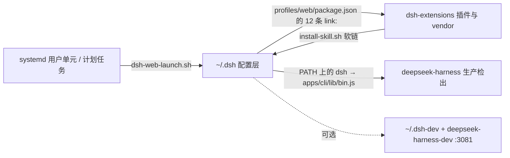

# INSTALL — 在新设备重建这套 DSH 工作栈

面向**新设备首次安装**与**同机重装**：人照着敲，AI 照着执行。
本文件按 **2026-11-24 的架构**重写。相比上一版（2026-09 快照）变化的地方，正是最容易装错的地方：

- composition 从 YAML 迁到 **TOML**（`cordis.toml` / `cordis.patch.toml`），旧 `cordis.patch.yml` 已不再被读；
- 仓库构建入口从 pnpm 换成 **nub**（hoisted `node_modules`），pnpm 只剩装 `~/.dsh/profiles/*` 与插件目录的依赖；
- 生产与 dev 变成**双检出 + 双 home**（`deepseek-harness` :3080 / `deepseek-harness-dev` :3081，`~/.dsh` `main` / `~/.dsh-dev` `dev`）；
- 技能与工具的**按项目治理已停用**（`agent-configs` / `skill-filter` 不再生效，所有工作区看到全部技能）；
- 桌面合成器与 agent 座位工具收编成子仓库（`repos/*`），但它们只是**这台机器的**基础设施，不跟设备走。

**平台**：两个平台都在目标内，各自走完一条完整链路，命令**不混用**：
Linux = `bash` + systemd 用户单元；Windows = PowerShell + 计划任务。
验证状态如实分层：Linux 段逐条实测（DSH 0.2.2-rc.5，:3080 / :3081）；
Windows 段按**仓库代码与 `windows` 分支的实机事实**核对（工作区根、单检出、启动器脚本都已在该机跑过），
标 🧪 的三条仍待 Windows 实机复跑确认。

---

## 先决定装到哪一层

| 层 | 装完能做什么 | 章节 | 大致时间 |
|---|---|---|---|
| **A 最小可运行** | `dsh web` 起来、能开会话、bash/fs/jobs 等基础工具可用 | §1、§2.1–2.4、§2.6–2.7 | 30–60 分钟（大头是构建） |
| **B 完整工作栈** | 叠加 6 个自研插件、技能面、hooks、MCP、super-agent / task-manager | §2.5、§3、§7 | +20 分钟 |
| **C 本机独有** | niri fork、agent 桌面、观测/守护、gitserver、ego 共享 profile | §6 | **其他设备不装** |

> 只想要「能跑起来的 DSH」：A 就够，B 里任何你不认识的组件都可以跳过。
> 想要「和主仓一样的生产力」：A+B。C 是这台桌面的特化，装错了只会互相拖累。
>
> **按平台走**：Linux → §1、§2、§3；Windows → §1、**§5**（§3 的 systemd 换成 §5.6 的计划任务）。
> §4 只有 Linux 生产机需要；§6 两个平台都别装。

---

## 0. 装什么：拓扑与依赖方向（2026-11-24 实测）

| 组件 | 规范路径 | 角色 | 来源 | 新设备 |
|---|---|---|---|---|
| 工作区 | `~/projects/MyAI` | 宿主层，7 个顶层子模块 | `github.com/xgx1/MyAI-workspace` | 必装 |
| DSH 本体（生产） | `~/projects/MyAI/deepseek-harness` | :3080 跑的就是它（分支 `master`） | `github.com/xgx1/deepseek-harness` | 必装 |
| DSH 本体（dev） | `~/projects/MyAI/deepseek-harness-dev` | `dev` 工作树，:3081 | 同一个 `.git` | 可选（§4） |
| 扩展集合 | `~/projects/MyAI/dsh-extensions` | 6 自研插件 + 5 vendor + 技能分组仓 | `github.com/xgx1/dsh-extensions` | B |
| 扩展 dev 工作树 | `~/projects/MyAI/dsh-extensions-dev` | 插件改动的落点 | 同上 `.git` | 可选（§4） |
| 配置层 | `~/.dsh` | composition TOML、hooks、bin、deploy unit 源 | `github.com/xgx1/dsh-home` 的 `main` | 必装 |
| 配置 dev 层 | `~/.dsh-dev` | 同一个仓的 `dev` 工作树 | 同上 | 可选（§4） |
| 桌面子仓 | `~/projects/MyAI/repos/{niri,smithay,agent-desktop,agent-seat-probe}` | 本机合成器 / agent 座位工具 | **本机 gitserver**（`/home/sx/projects/gitserver/*.git`） | 不装（§6） |



**两台的现实不同，别照抄另一台**：

| | Linux（Arch，本机） | Windows（另一台，已跑过） |
|---|---|---|
| 检出 | 生产 + dev 双检出（`deepseek-harness` / `-dev`） | **单检出**：只有 `deepseek-harness`，没有 `-dev`、没有 :3081 |
| 工作区根 | `~/projects/MyAI` | `C:\Users\<你>\Project\MyAI`（`windows` 分支的既有布局） |
| 配置层分支 | `main` | `windows`（合并方向见 `~/.dsh/README.md`「多机：分支约定」） |
| 执行器 | `bash-local`（已就位） | `pwsh-local` + `tool-pwsh`（要补，§1.4） |
| 服务 | systemd 用户单元 | 计划任务 `dsh-web` |

**三条硬约束**（装错都卡在这三处）：

1. `~/.dsh` 重建不了环境——`profiles/web/package.json` 有 **12 条绝对** `link:`，必须先有项目、后装配置层。
2. 插件与 vendor 的 `lib/`、`dist/` 是构建产物、不入库；克隆完必须构建，否则 profile 起不来。
3. 服务最后装：重启 `dsh-web` **会中断当前对话**（如果你正跑在它上面）。

**给 AI 的执行约定**：逐节执行，每节以「**验收**」为完成判据——验收不过不进下一节；
失败先读报错原文再改方案；用户名不是 `sx` 或目录不是 `/home/sx/projects/MyAI` 时，先做 §1.3 的路径改写。

---

## 1. 前置：路径与工具链

### 1.1 规范路径（下文所有命令都基于它）

```bash
export WS="$HOME/projects/MyAI"           # 本工作区
export EXT="$WS/dsh-extensions"           # 扩展集合
export HARNESS="$WS/deepseek-harness"     # DSH 生产检出
export HARNESS_DEV="$WS/deepseek-harness-dev"   # 仅 §4
export EXT_DEV="$WS/dsh-extensions-dev"         # 仅 §4
export DSH_HOME="$HOME/.dsh"              # 生产配置层
export DSH_HOME_DEV="$HOME/.dsh-dev"      # 仅 §4
export PATH="$HOME/.local/bin:$HOME/.nub/bin:$PATH"
```

```powershell
$WS       = "$env:USERPROFILE\Project\MyAI"      # windows 分支的既有布局；要改成 projects\ 就同步改启动器与 link:
$EXT      = "$WS\dsh-extensions"
$HARNESS  = "$WS\deepseek-harness"
$DSH_HOME = "$env:USERPROFILE\.dsh"
$env:PATH = "$env:USERPROFILE\.local\bin;$env:USERPROFILE\.nub\bin;$env:PATH"
```

### 1.2 工具链

| 工具 | 版本要求 | Linux（Arch） | Windows |
|---|---|---|---|
| git | ≥ 2.26 | `sudo pacman -S --needed git` | `winget install Git.Git` |
| Node.js | `^22.19 \|\| >=24`（生产机实测 v26.13.1） | `sudo pacman -S --needed nodejs npm` | `winget install OpenJS.NodeJS.LTS` |
| **nub** | **≥ 0.11**（harness 的 `package.json#devEngines` 声明） | `curl -fsSL https://nubjs.com/install.sh \| bash` → `~/.nub/bin/nub` | `irm https://nubjs.com/install.ps1 \| iex`（PowerShell），或 `npm i -g @nubjs/nub` |
| pnpm | 任意 9+ | `sudo pacman -S --needed pnpm` | `npm i -g pnpm` |
| C 编译器 | Linux 构建 native 插件必需 | `sudo pacman -S --needed base-devel` | 不需要（native 段在 Windows 空转） |
| .NET SDK 10 | 可选：ps-tool 的更新 CLI（§9） | `sudo pacman -S --needed dotnet-sdk` | `winget install Microsoft.DotNet.SDK.10` |
| uv | 可选：MCP 与工具（§7） | `sudo pacman -S --needed uv` | `winget install astral-sh.uv` |

**nub 与 pnpm 的分工**（别混）:

- `nub install` / `nub run build` 只用于 **harness 检出**（hoisted 布局，`.npmrc` 里 `node-linker=hoisted`）；
- `pnpm install` 只用于 **`~/.dsh/profiles/*` 与 `dsh-extensions` 的插件/vendor 目录**。

**运行时前置**（不装就在 profile 里静默消失，见 §7）：`codebase-memory-mcp`、`@zvec/zvec-grep`、
`uvx` 拉起的 `mcpforunityserver`、以及被操作的编辑器本身（UE / Unity / Blender）。

```bash
# 可选但常用（Linux）：
uv tool install codebase-memory-mcp            # -> ~/.local/bin/codebase-memory-mcp
npm i -g --allow-scripts=@zvec/zvec-grep @zvec/zvec-grep && ln -sfn ~/.npm-global/bin/zg ~/.local/bin/zg
```

**验收**：`node -v` ≥ 22.19、`nub --version` ≥ 0.11、`pnpm -v` 有输出，
且 `for c in git node nub pnpm cc; do command -v $c; done` 全部有路径（Windows 段 `cc` 除外）。

### 1.3 路径改写（目录/用户名不是 `/home/sx` 时必做）

`/home/sx` 目前出现在 **3 个文件**：`~/.dsh/profiles/web/package.json`（12 处 `link:`）、
`pnpm-lock.yaml`（24 处）、`cordis.patch.toml`（4 处）。前两个要改成你的路径；
`cordis.patch.toml` 里那 4 处指向**本机独有**的东西（`~/.local/bin/uvx-no-proxy`、`~/.dsh/bin/zg-autoidx.mjs`、
ego 运行时的 `egoBin`）——新设备**不装**，按 §6 把那两条 `mcp-unity` / `ego-browser` 条目 `disabled = true`。

`dsh-extensions` 的插件 devDependencies 自 2026-11 起已是相对路径（`link:../../deepseek-harness/...`），无需改写。

```bash
# 在 §2.5 之前执行；幂等，重复跑无害
grep -rl '/home/sx/projects/MyAI' --include=package.json --include=pnpm-lock.yaml \
     "$DSH_HOME/profiles" "$EXT/plugins" 2>/dev/null \
  | grep -v node_modules \
  | xargs -r sed -i "s|/home/sx/projects/MyAI|$HOME/projects/MyAI|g"
```

```powershell
$old = '/home/sx/projects/MyAI'
$new = ($WS -replace '\\','/')          # JSON 里用正斜杠，避免反斜杠转义
Get-ChildItem -Path "$DSH_HOME\profiles", "$EXT\plugins" -Recurse -Include package.json,pnpm-lock.yaml -File |
  Where-Object { $_.FullName -notmatch '\\node_modules\\' } |
  ForEach-Object { (Get-Content -Raw $_.FullName).Replace($old,$new) | Set-Content -NoNewline $_.FullName }
```

**验收**：`grep -rn '/home/sx/projects/MyAI' --include=package.json --include=pnpm-lock.yaml "$DSH_HOME/profiles" "$EXT/plugins" | grep -v node_modules` 无输出。
（家目录本来就是 `/home/sx` 时这条永远有输出——那是**不需要改写**的信号，别为此改文件。）

### 1.4 平台规则：shell 执行器只挂本平台那个（Linux = bash，Windows = pwsh）

shell 能力分两个平面，**两个平面都要对上，同一平台只挂一种 shell**：

| 平面 | Linux | Windows | 落点 |
|---|---|---|---|
| 模型工具（一次性命令） | `@deepseek-ai/dsh-tool-bash` | `@deepseek-ai/dsh-tool-pwsh` | `~/.dsh/profiles/web/cordis.patch.toml` 的 `preset-all` 区块（**现状只挂了 `tool-bash`**，见下） |
| 执行器（host 平面，真正起进程） | `@deepseek-ai/dsh-bash-local` | `@deepseek-ai/dsh-pwsh-local` | 同文件顶部的 `[[entry.insert]]` 条目 |

**必须写成平台表达式，不能写死 `disabled = true`**：`~/.dsh` 是跨设备同步的同一份文件，写死会在另一平台把 shell 全关掉。
TOML 里表达式是字符串（与 YAML 的 `!!js` 不同）：

```toml
[[entry]]
[[entry.insert]]
id = "bash-local"
name = "@deepseek-ai/dsh-bash-local"
disabled = "js:process.platform === 'win32'"     # Windows 上自动关掉

[[entry.insert]]
id = "pwsh-local"
name = "@deepseek-ai/dsh-pwsh-local"
disabled = "js:process.platform !== 'win32'"     # 非 Windows 上自动关掉
```

现状（生产机实测，2026-11-24）：执行器 `bash-local` 出现两次——顶部 `[[entry.insert]]` 与中段带 `timeoutMs` 的 `[[entry]] id = "bash-local"`——
**没有** `pwsh-local`；模型工具平面也只有 `tool-bash`（带 `disabled = "js:process.platform === 'win32'"`）、**没有** `tool-pwsh`。

Linux 设备照现状即可。Windows 设备要补**两处**（一次改好、之后两台设备同源、pull 即用）：

```toml
# ① host 平面：执行器（替换原来那条 bash-local 的 [[entry.insert]]，见上面两行式）
# ② 模型工具平面：preset-all 的 plugins 数组里追加
[[entry.insert.config.plugins]]
id = "tool-pwsh"
name = "@deepseek-ai/dsh-tool-pwsh"
disabled = "js:process.platform !== 'win32'"
```

补完在 `~/.dsh` 里 commit + push；Linux 那台 pull 后两条表达式自动翻面，不受影响。
两处都缺时 Windows 上「模型看得见 bash、却没有能起 bash 的执行器」——表现为每条命令都失败。

**验收（Linux，`~/.dsh` 装好后）**：

```bash
grep -n -A2 'id = "bash-local"' "$DSH_HOME/profiles/web/cordis.patch.toml"   # 条目在
grep -c 'pwsh-local' "$DSH_HOME/profiles/web/cordis.patch.toml"              # 0（Linux 现状）或 1（两行式）
```
最强证据是运行时：新开会话，Linux 上模型只该拿到 `bash`，没有 `pwsh`。

---

## 2. Linux 安装

### 2.1 拉工作区与全部子模块（`repos/*` 除外）

顶层 7 个子模块里，`repos/{niri,smithay,agent-desktop,agent-seat-probe}` 的 `.gitmodules` URL 指向**本机 gitserver**
（`/home/sx/projects/gitserver/*.git`），其他设备拉不到——所以**只初始化通用的三个**：

```bash
mkdir -p ~/projects && cd ~/projects
git clone https://github.com/xgx1/MyAI-workspace.git MyAI
cd "$WS"
git submodule update --init --recursive deepseek-harness dsh-extensions dsh-Go
```

**验收**：

```bash
git -C "$WS" submodule status deepseek-harness dsh-extensions dsh-Go | grep -c '^-'   # 期望 0
git -C "$WS" submodule status --recursive | wc -l                                   # 本机 33；你的机器少 4 个 repos/*
```

`repos/*` 保持未初始化是**正常状态**，`git status` 里显示为未初始化不影响构建。要装它们见 §6。

### 2.2 构建 DSH 本体

```bash
cd "$HARNESS"
nub install          # hoisted 布局；本条也是后续所有插件的解析基础
nub run build        # 分钟级：native 插件(cc) → host/client lib → web 前端
```

`nub run build` = `build:native-system` + `build:lib` + `build:web`（Windows 上 native 段空转）。
报 `Node-API headers missing` 说明 Node 没带头文件（Arch 的 `nodejs` 自带 `/usr/include/node`）；
报 `cc` 找不到（`ENOENT` / `spawnSync cc`）说明缺编译器，装 `base-devel`。
依赖的 install 脚本默认被 nub 拒绝：需要时在 `package.json#allowScripts` 里放行并 `nub ci`。

**验收**：`node "$HARNESS/apps/cli/lib/bin.js" --version` 打印版本号（本机 `0.2.2-rc.5`）。

### 2.3 让 `dsh` 上 PATH

```bash
mkdir -p ~/.local/bin
ln -sfn "$HARNESS/apps/cli/lib/bin.js" ~/.local/bin/dsh
chmod +x "$HARNESS/apps/cli/lib/bin.js"
```

**验收**：`command -v dsh && dsh --version` 两行都有输出。

### 2.4 构建扩展（最容易漏的一步）

`plugins/*/lib/`、`vendor/*/lib|dist/` 都是构建产物、被 `.gitignore` 排除，克隆后必须逐个 build。
插件 `package.json` 的 devDependencies 用**相对** `link:` 指向 harness 检出，所以 §2.2 必须先做完。

```bash
for p in "$EXT"/plugins/*/; do (cd "$p" && pnpm install && pnpm run build); done

(cd "$EXT/vendor/billion-context" && pnpm install && pnpm run build)   # 产物在 dist/
(cd "$EXT/vendor/dsh-blender-plugin" && pnpm install && pnpm run build) # 产物在 lib/
```

`vendor/OpenViking/examples/dsh-memory-plugin`（记忆插件）与 `vendor/{opencode2dsh,dsh-our-free-model}`
是裸 `.mjs` / 源码，**无需构建**；profile 只挂前者。

**验收**（全部存在才算过）：

```bash
for f in "$EXT"/plugins/*/lib/index.js "$EXT/vendor/billion-context/dist/index.js" "$EXT/vendor/dsh-blender-plugin/lib/constants.js"; do
  [ -e "$f" ] && echo "ok  $f" || echo "MISS $f"
done
```

### 2.5 装配置层 `~/.dsh`

```bash
# ① 取回仓库（目录不存在就 clone；已存在且有运行时数据则按 ~/.dsh/README.md「新设备恢复」）
git clone https://github.com/xgx1/dsh-home.git ~/.dsh

# ② 路径改写：现在跑一遍 §1.3

# ③ 重建 profile 依赖（12 条 link: 指向 §2.2/§2.4 的产物）
cd "$DSH_HOME/profiles/web"
pnpm install --registry=https://registry.npmmirror.com --prefer-offline   # 国内网络；能直连 registry.npmjs.org 就省掉前面两个参数
#    等价且更官方的入口：dsh plugin --profile web install（参数原样转发给 pnpm，profile 缺失时先初始化）
mkdir -p patches        # 空目录不进 git，但 composition 需要它存在

# ④ 凭据：三选一，优先级从高到低
cp "$DSH_HOME/keys.example.yaml" "$DSH_HOME/.credentials.yaml"
chmod 600 "$DSH_HOME/.credentials.yaml"      # 非 600 时 DSH 拒绝加载（POSIX）；顶层只允许 version/refs/records
#    最少填一个 DEEPSEEK_API_KEY；其余 provider 的键按需。
#    或直接用 dsh 配置界面逐个保存；或用启动环境覆盖：DEEPSEEK_API_KEY=… dsh web。
#    当前 profile 里要用到的键名：grep -o 'apiKeyEnv = "[A-Z_]*"' "$DSH_HOME/profiles/web/cordis.patch.toml"

# ⑤ 技能软链（本机 386 条，指向 dsh-extensions/skills、ps-tool/skills、各项目 .dsh/skills）
mkdir -p "$DSH_HOME/skills"                      # 该目录被 gitignore，新机不存在时安装器会直接退出
bash "$EXT/install-skill.sh" --dry-run
bash "$EXT/install-skill.sh"
#    源② 默认是 /mnt/Video2/ps-tool/.dsh/skills（本机路径）：没有 ps-tool 就跳过，
#    或 PSTOOL_SKILLS_ROOT=<你的 ps-tool 目录> bash ./install-skill.sh

# ⑥ hooks 前置：ponytail / caveman 两个技能分组仓已 checkout（§2.1 的 recursive 已覆盖），
#    且 dsh-web 的 PATH 上有 node（hook 用 bash -c 起 node 脚本）。
```

**验收**：

```bash
ls "$DSH_HOME/skills" | wc -l; find "$DSH_HOME/skills" -maxdepth 1 -type l | wc -l      # 两个数相等（全软链无副本）
bash "$EXT/install-skill.sh" --dry-run | grep '完成：'   # 幂等性：连跑两遍，第二遍必须「新建 0」
                                                 # （第一遍可能补上仓库里新加的技能，属正常）
test -f "$DSH_HOME/profiles/web/node_modules/dsh-task-manager/package.json" && echo profile-ok
```

### 2.6 冒烟：手动起一次 Web UI

```bash
cd ~ && dsh web --no-open >/tmp/dsh-smoke.log 2>&1 &
sleep 25
curl -s http://127.0.0.1:3080 | head -c 60     # 期望：dsh web authentication required…
kill %1
```

**验收**：上面 `curl` 打印 `dsh web authentication required; reopen the URL printed by dsh web.`
——**401 就是健康**：服务在跑，只是没带访问令牌。真正可点的地址是启动时打印的 `?token=…`。

想要「重启后链接不变、标签页不再 401」，在启动脚本里给固定 token（仓库公开，token 值存到不入库的文件）：

```bash
# 加到 ~/.dsh/dsh-web-launch.sh 的 exec 之前
TOKEN_FILE="$HOME/.dsh/.web-token"
[ -s "$TOKEN_FILE" ] || { head -c 32 /dev/urandom | base64 | tr '+/' '-_' | tr -d $'=\n' > "$TOKEN_FILE"; chmod 600 "$TOKEN_FILE"; }
export DSH_WEB_TOKEN="$(cat "$TOKEN_FILE")"
```
（`packages/host/authentication-token/src/browser-auth.ts:65` 读这个变量；`~/.dsh-dev` 的启动脚本已有同样一段。）

---

## 3. Linux 部署为 systemd 用户服务

unit 的权威副本在 `~/.dsh/deploy/systemd-user/`（**不在** `~/.config/systemd/user/`，那里不受 git 管理）。

```bash
"$DSH_HOME/deploy/install-systemd-units.sh" --dry-run   # 先看会写什么
"$DSH_HOME/deploy/install-systemd-units.sh"             # 写入 + daemon-reload + enable 全部

systemctl --user start dsh-web.service                  # ← 会中断当前对话，确认后再敲
loginctl enable-linger "$USER"                          # 可选：不登录也随开机自启
```

**脚本会把目录里全部 unit 都 `enable`**（不 start）。timer 一旦 enable 就会自己跑，所以装完立刻把用不到的关掉。

| unit | 作用 | 前置 | 建议 |
|---|---|---|---|
| `dsh-web.service` | 生产实例 :3080 | §2 全部 | 必须 |
| `dsh-web-dev.service` | dev 实例 :3081 | §4 | 只在做 DSH 开发时 |
| `dsh-janitor.timer` | 清残留子进程、MSBuild 复用、日志 | `python3` | B，推荐 |
| `dsh-guard.timer` | 只读扫描本机其它 DSH 会话的违规动作 | `python3` | B，多会话环境推荐 |
| `dsh-observe.timer` | 每分钟整屏截图 + 窗口/工作区快照 | `grim` + 本机 Wayland 合成器 socket | C，其他设备**关掉** |
| `dsh-view.service` | :8793 观测面板（看/接手别的桌面） | 上面两项的数据 | C，其他设备**关掉** |
| `opencode-zen-bridge.service` | :8790 OpenAI 兼容端点（免费额度 provider） | `python3` | 只在用 `opencode-zen` provider 时 |
| `openviking-server.service` | :1933 记忆后端（OpenViking 插件） | `uv tool install openviking` | 只在用记忆插件时 |

```bash
# 用不到的立刻关掉（enable 过的 timer 会自动跑，失败会刷 journal）
for u in dsh-observe.timer dsh-view.service dsh-web-dev.service opencode-zen-bridge.service openviking-server.service; do
  systemctl --user disable --now $u 2>/dev/null
done
```

**验收**：

```bash
systemctl --user is-active dsh-web                              # active
curl -s -o /dev/null -w '%{http_code}\n' http://127.0.0.1:3080  # 401 = 健康
journalctl --user -u dsh-web --no-pager | grep -o 'http://127.0.0.1:3080/?token=[^ ]*' | tail -1
```
最后一行给出**可直接在浏览器打开的地址**（含令牌），这是唯一能真正进 UI 的入口。

`dsh-web-launch.sh` 里那几行 `export`（`WAYLAND_DISPLAY` / `XDG_CURRENT_DESKTOP` / `TMPDIR` / `BILI_NATIVE_DSH_LANE`）
是**这台机器**的环境：Hyprland、`/mnt/Storage/tmp`、生产 lane。换设备时按自己的桌面改，或删掉——
不设 `XDG_CURRENT_DESKTOP` 时 cua-driver 的 Wayland 通道会拒绝操作原生窗口（X11 通道仍可用）。

---

## 4. dev 实例（可选；**只有 Linux 生产机需要**，Windows 是单检出）

三个工作树：`deepseek-harness-dev`（`dev`）、`dsh-extensions-dev`（`dev`）、`~/.dsh-dev`（`dev`）。
dev 实例 :3081，`DSH_HOME=~/.dsh-dev`，sessions/storages 与生产隔离。

```bash
# 已经 clone 出来的检出里补工作树（本机已存在，新设备按需）
git -C "$HARNESS" worktree add "$HARNESS_DEV" dev
git -C "$EXT"     worktree add "$EXT_DEV" dev
git -C "$DSH_HOME" worktree add "$DSH_HOME_DEV" dev
```

dev home 的配置层**自己一份**（composition 是 TOML；自 2026-11-16 起 dev 也用 TOML，不再有 YAML）：

```bash
# 把生产配置层搬过去，并把 link: 指回 -dev 检出
for f in cordis.patch.toml profiles/web/{cordis.toml,cordis.patch.toml,package.json,pnpm-lock.yaml,pnpm-workspace.yaml}; do
  cp "$DSH_HOME/$f" "$DSH_HOME_DEV/$f"
done
sed -i 's#MyAI/deepseek-harness/#MyAI/deepseek-harness-dev/#g; s#MyAI/dsh-extensions/#MyAI/dsh-extensions-dev/#g' \
  "$DSH_HOME_DEV"/profiles/web/{package.json,pnpm-lock.yaml,cordis.patch.toml}

( cd "$HARNESS_DEV" && nub install && nub run build )
( cd "$EXT_DEV"     && bash ./install-skill.sh --dry-run )
( cd "$DSH_HOME_DEV/profiles/web" && pnpm install --registry=https://registry.npmmirror.com --prefer-offline )
systemctl --user enable --now dsh-web-dev.service
```

**纪律**（工作区 AGENTS.md）：DSH 的代码/配置改动只做在 `-dev` 检出，`deepseek-harness` 是生产检出、默认只读；
生产层与 dev 层靠**搬文件**同步，不靠 git merge（orphan 分支没有共同祖先）。

**验收**：`curl -s -o /dev/null -w '%{http_code}\n' http://127.0.0.1:3081` 返回 401，`systemctl --user is-active dsh-web-dev` 为 active。

---

## 5. Windows 安装

Windows 与 Linux 是**两条同构的链路**，不是附录：同样的检出、同样的 TOML composition、同样的 nub 构建。
差异只有四处——没有 `cc`（native 段在 Windows 空转，`native/system/scripts/build.ts:27` 对非 linux/macOS 直接返回）、
`dsh` 用 `dsh.cmd` 垫片、执行器换 `pwsh-local`（外加 `tool-pwsh`）、服务换计划任务。其余步骤与 §2 一一对应，下文只写不同处。

**Windows 机的现状（来自 `windows` 分支的 AGENTS.md，已在该机跑过）**：工作区根是 `C:\Users\Admin\Project\MyAI`
（是 `Project`，不是 `projects`）；只有**单检出** `deepseek-harness`（没有 `-dev`、没有 3081）；配置层常驻 `windows` 分支，
`link:` 指向 `C:\Users\Admin\Project\MyAI\dsh-extensions`。

`windows` 分支里还留着 `cordis.patch.yml`、`.agent-presets`、`skill-filter.yaml`——那是 YAML 世代遗留，`main` 已是 TOML。
正确顺序是：**照 `main` 的 TOML 结构装，只把「换平台就该不一样」的东西留在 `windows` 分支**，改完回流 `main`。

### 5.1 预检

```powershell
# 长路径（node_modules 层级很深；不开会在依赖安装阶段随机失败）
git config --global core.longpaths true
reg query "HKLM\SYSTEM\CurrentControlSet\Control\FileSystem" /v LongPathsEnabled   # 期望 0x1
node -v; nub --version; pnpm -v                                                     # 三个都要有输出，nub ≥ 0.11
```

### 5.2 拉工作区与子模块

```powershell
New-Item -ItemType Directory -Force -Path "$env:USERPROFILE\Project" | Out-Null
git clone https://github.com/xgx1/MyAI-workspace.git "$WS"
Set-Location $WS
git submodule update --init --recursive deepseek-harness dsh-extensions dsh-Go   # repos/* 跳过（§2.1 同理）
```

**验收**：`git submodule status deepseek-harness dsh-extensions dsh-Go | Select-String '^-'` 无输出。

### 5.3 构建 DSH 本体 + `dsh` 命令

在 **Git Bash** 里跑构建（与 Linux 同一套脚本）：`cd "$HARNESS" && nub install && nub run build`。
nub 装完先重开 Git Bash 确认 `command -v nub` 有输出（安装器改的是用户 PATH，旧终端不生效）。
Windows 没有符号链接式安装，用 `dsh.cmd` 垫片：

```powershell
New-Item -ItemType Directory -Force -Path "$env:USERPROFILE\.local\bin" | Out-Null
@'
@echo off
node "%USERPROFILE%\Project\MyAI\deepseek-harness\apps\cli\lib\bin.js" %*
'@ | Set-Content -Encoding ASCII "$env:USERPROFILE\.local\bin\dsh.cmd"

$userPath = [Environment]::GetEnvironmentVariable('Path','User')
if ($userPath -notlike "*\.local\bin*") {
  [Environment]::SetEnvironmentVariable('Path', "$env:USERPROFILE\.local\bin;$userPath", 'User')
}
```

**验收**：新开 PowerShell → `dsh --version`。

### 5.4 构建扩展

先做 §1.3 的 PowerShell 版路径改写，再在 Git Bash 里跑与 §2.4 **完全相同**的循环（`pnpm install && pnpm run build`）。
验收同 §2.4。

### 5.5 配置层 + 平台执行器

```powershell
git clone https://github.com/xgx1/dsh-home.git "$DSH_HOME"
git -C "$DSH_HOME" checkout windows          # Windows 侧常驻 windows 分支（合并方向见 README）
# 路径改写（§1.3 PowerShell 段）
Set-Location "$DSH_HOME\profiles\web"
pnpm install                          # 国内网络加 --registry=https://registry.npmmirror.com --prefer-offline
#   或等价：dsh plugin --profile web install
New-Item -ItemType Directory -Force -Path patches | Out-Null
Copy-Item "$DSH_HOME\keys.example.yaml" "$DSH_HOME\.credentials.yaml"   # Windows 不检查 POSIX 权限位
```

**执行器 + 工具**：编辑 `$DSH_HOME\profiles\web\cordis.patch.toml`：把 `bash-local` 那条 `[[entry.insert]]` 改成 §1.4 的两行式
（新增 `pwsh-local`），并在 `preset-all` 的 plugins 数组补一条 `tool-pwsh`（两段 TOML 都在 §1.4）。改完在 `~/.dsh` 里 commit + push，
Linux 那台 pull 后同样成立——**一台机器改，两边同源**。

**技能软链**：`install-skill.sh` 是 bash 脚本，Windows 走 **Git Bash** 最稳：

```bash
export MSYS=winsymlinks:nativestrict
mkdir -p ~/.dsh/skills
bash ~/Project/MyAI/dsh-extensions/install-skill.sh --dry-run
bash ~/Project/MyAI/dsh-extensions/install-skill.sh
```

建不了软链时按代价排序：① 开「开发者模式」后重开 Git Bash（推荐，之后与 Linux 等价）；
② 管理员身份跑 Git Bash；③ 退回复制（`install-skill.sh --list` 打印每个技能的源目录，逐个 `Copy-Item -Recurse`）——
复制即副本，改完技能要重复制，是下策。

**hooks 需要 bash**：`~/.dsh/cordis.patch.toml` 里的 hooks 桥用 `bash -c` 起 node（ponytail / caveman 的上下文注入就走这条）。
所以 Windows 上 **Git Bash 必须在 PATH 里**：装 Git 默认只给快捷方式、不进 PATH，要把 `<Git>\bin\bash.exe` 所在的 `bin` 目录加进用户 PATH。
不加也不影响 DSH 启动，只是两个技能钩子静默不生效。

### 5.6 冒烟与开机自启

```powershell
$p = Start-Process -FilePath "$env:USERPROFILE\.local\bin\dsh.cmd" -ArgumentList 'web','--no-open' -PassThru -NoNewWindow
Start-Sleep -Seconds 25
try { Invoke-WebRequest -UseBasicParsing http://127.0.0.1:3080 } catch { $_.Exception.Response.StatusCode.value__ }   # 401
taskkill /T /F /PID $p.Id
```

启动器脚本：`%USERPROFILE%\.dsh\dsh-web-launch.ps1`。`origin/windows` 里已有一份**实机跑过**的版本，直接取用再改工作区根：

```powershell
git -C "$DSH_HOME" show origin/windows:dsh-web-launch.ps1 > "$DSH_HOME\dsh-web-launch.ps1"
# 然后编辑：把 Set-Location 那行改成你的工作区根（$WS）；要用固定入口 token 就在 exec 前加 $env:DSH_WEB_TOKEN = ...
```

它做的事：设 `DSH_HOME`、把 `~\.local\bin` 加进 PATH、切到工作区根、前台跑 `dsh web --no-open`（`-Service` 时追加日志到 `dsh-web.log`）。
**凭据不在启动器里注入**：DSH 自己从 `$DSH_HOME\.credentials.yaml` 按 `apiKeyEnv` 的名字解析（优先级 环境 > 存储 > `.env`）。
（Linux 那份 `dsh-env.sh` 是把 `*_API_KEY` 额外导出进进程环境，属可选加强，不是必需。）

```powershell
$Launcher = "$env:USERPROFILE\.dsh\dsh-web-launch.ps1"
$Action   = New-ScheduledTaskAction -Execute 'powershell.exe' -Argument "-NoProfile -ExecutionPolicy Bypass -File `"$Launcher`" -Service"
$Trigger  = New-ScheduledTaskTrigger -AtLogOn -User "$env:USERDOMAIN\$env:USERNAME"
# 看门狗：每 5 分钟检查一次，没在跑就拉起（对应 Linux 的 Restart=always）
$Trigger.Repetition = (New-ScheduledTaskTrigger -Once -At (Get-Date) `
  -RepetitionInterval (New-TimeSpan -Minutes 5) -RepetitionDuration ([TimeSpan]::FromDays(3650))).Repetition
$Settings = New-ScheduledTaskSettingsSet -AllowStartIfOnBatteries -DontStopIfGoingOnBatteries `
  -RestartCount 999 -RestartInterval (New-TimeSpan -Minutes 1) `
  -ExecutionTimeLimit ([TimeSpan]::Zero) -MultipleInstances IgnoreNew
Register-ScheduledTask -TaskName 'dsh-web' -Action $Action -Trigger $Trigger -Settings $Settings
```

三条都不能省，各治一种「服务静默趴窝」：`-ExecutionTimeLimit 0` 防计划任务 3 天后掐掉长跑服务；
`Repetition` 补「进程正常退出（退出码 0）后任务视作已完成、永不重启」；
`-MultipleInstances IgnoreNew` 防止看门狗把已在跑的实例又起一个。

**验收**：`Get-ScheduledTask -TaskName 'dsh-web' | Select-Object State` 为 Running，`curl :3080` 返回 401。
重启电脑后再验一遍（任务 State、401、`dsh-web.log` 里新的 `?token=` 地址），三条都过才算「开机自启成立」。

**🧪 待 Windows 实机确认的三条**（本文其余 Windows 步骤都有实机来源：`windows` 分支 AGENTS.md / 启动器脚本 / 仓库代码）：

1. `pwsh-local` + `tool-pwsh` 两处 TOML 都生效——新会话里模型只拿到 `pwsh`，且命令能真正跑起来；
2. 计划任务的 `-Repetition` 看门狗参数（`windows` 分支只记录了「任务指向启动器」，注册参数未存档）；
3. `install-skill.sh` 在 Git Bash + 开发者模式下的软链数量与 Linux 一致（或按 §5.5 的退路复制）。

---

## 6. 本机独有层（其他设备不装）

这些东西跟**这台机器**绑定，装到别的设备只会互相拖累（缺依赖、抢 socket、刷 journal）。

| 东西 | 位置 | 前置 | 为什么不跟设备走 |
|---|---|---|---|
| niri fork（scoped-input） | `repos/niri`、`/usr/local/bin/niri` | 本机合成器会话 | 生产桌面自 2026-11-05 跑 fork；上游 niri 已卸载。装它 = 换掉整台机器的窗口管理器 |
| smithay / agent-seat-probe / agent-desktop | `repos/*`、`~/.dsh/bin/agent-*` | niri fork 的 socket | 后台窗口控制只存在于 fork |
| 观测与守护 | `~/.dsh/bin/{dsh-guard,dsh-observe,dsh-desktops,dsh-view,ego-tab-janitor,zg-autoidx}.py|mjs` | python3 / grim / niri socket | 盯的是本机的其它会话与桌面 |
| `prod-niri` / `prod-xdo` / `prod-grim` / `hypr-place` | `~/.dsh/bin/` | 生产合成器 | 都是「穿透 agent 桌面、操作人的桌面」的包装 |
| ego 共享 profile | `~/.local/share/ego-lite-runtime/bin/ego-shared-bili.mjs`（`profiles/web/cordis.patch.toml` 约 1247 行的 `egoBin`） | 用户浏览器带 `--remote-debugging-port=9222` | 挂的是**用户自己**的浏览器进程，换设备路径与启动方式都不同 |
| opencode-zen bridge | `~/.dsh/bin/opencode-zen-bridge.py`（unit :8790） | 本机出口 IP 的免费额度 | 免费层与本机网络绑定 |
| gitserver | `/home/sx/projects/gitserver/*.git` | 只是本机归档仓 | `repos/*` 的 `.gitmodules` URL 指向它，所以新设备拉不动 |
| `/mnt/Storage/tmp` | `dsh-web-launch.sh` 的 `TMPDIR` | 大盘挂载点 | 治的是本机 tmpfs 配额被修复样本打满的坑 |

要装某一行（比如你就是要把 agent 桌面复制过去）：先加载技能 `background-window-control`，
里面写清了 fork 的构建、seat 绑定、回归夹具与红线；不要照 INSTALL 硬抄。

---

## 7. 运行时依赖：装了配置 ≠ 能用

profile 里的 MCP 客户端是 `failOnStartupError: false`——**命令不存在时静默跳过，不报错**，
面板上看不见、日志里也没有。装完逐条 `command -v` 核对。

另外三条在当前 profile 里是 **`disabled = true`**（`mcp-ue`、`mcp-unity`、`mcp-rea`）：装了编辑器/二进制之后，
还要在 `cordis.patch.toml` 里把对应条目的 `disabled` 去掉，否则「装了也没用」。`mcp-cbm`、`mcp-zvecgrep` 是默认开的。

| profile 条目 | 需要的东西 | 装法 |
|---|---|---|
| `mcp-cbm` | `codebase-memory-mcp` + 常驻 daemon | `uv tool install codebase-memory-mcp`；用户级 unit `codebase-memory.service`（**更新二进制后必须重启它**，否则旧 inode 顶着，全线超时） |
| `mcp-zvecgrep` | `zg`（原生二进制）+ 嵌入模型 | `npm i -g --allow-scripts=@zvec/zvec-grep @zvec/zvec-grep`，软链到 `~/.local/bin/zg` |
| `mcp-ue` | 运行中的 UE 编辑器 MCP（`http://127.0.0.1:8000/mcp`） | 装 unreal-mcp 插件并启动编辑器；不装就该条目停用 |
| `mcp-unity` | `uvx` + `mcpforunityserver==10.3.0` + Unity 侧 UPM 包 | `uv tool install uv`（或系统 uv）；本机那份 `~/.local/bin/uvx-no-proxy` 是「清代理再 exec」的包装，新设备不装就把 `command` 改成 `uvx` |
| `mcp-rea` | `rea-agents` | `npm i -g rea-agents` |
| `ego-browser` | `dsh-ego-browser`（npm 包）+ 浏览器 + 本机 ego 包装 | `npm i -g` 后把 `egoBin` 指向你的启动器；Linux 共享 profile 用法见 §6 |
| `dsh-blender-plugin` | Blender + BlenderMCP 插件 | 装 Blender 与插件后，`dsh-blender.config.json` 指端口 |
| `openviking` 记忆插件 | `openviking-server`（:1933） | `uv tool install openviking`；配 `OPENVIKING_API_KEY` 等 |
| profile 里任何 provider | 对应的 `*_API_KEY` | `grep -o 'apiKeyEnv = "[A-Z_]*"' ~/.dsh/profiles/web/cordis.patch.toml` 一次列全 |

---

## 8. 常见坑

| 症状 | 原因 | 处置 |
|---|---|---|
| Windows：`dsh` 在旧终端里找不到 | 改用户 PATH 只对新进程生效 | 关掉所有终端重开（或 `$env:PATH` 只对当前会话生效） |
| Windows：`install-skill.sh` 报 `ln: failed to create symbolic link` | 没开「开发者模式」/ 不是管理员 | 开开发者模式后重开 Git Bash；或管理员跑；或退回 `Copy-Item` 复制（§5.5） |
| Windows：`git submodule` 又卡在 `repos/*` | 同上，URL 指向本机 gitserver | §5.2 只初始化三个路径 |
| Windows：PowerShell 里 `dsh web` 立即退出 | 用了 `powershell.exe` 但 PATH 里没有 `dsh.cmd` | 用 `%~dp0` 绝对路径或重开终端；确认 `dsh.cmd` 在 `~\.local\bin` |
| Windows：ponytail / caveman 不进上下文 | hooks 桥用 `bash -c`，Windows 上没有 bash | 把 Git 的 `bin` 目录加进 PATH（§5.5）；或临时禁用 hooks 条目 |
| Windows：中文/emoji 在日志里乱码 | 控制台编码 | `chcp 65001`，或让计划任务把输出写文件（`dsh-web-launch.ps1 -Service`） |
| `nub: command not found` / `nubx` 不认识 | nub 没装或不在 PATH | `curl -fsSL https://nubjs.com/install.sh \| bash`，把 `~/.nub/bin` 加进 PATH |
| `nub install` 拒跑某个依赖的 install 脚本 | nub 默认拒绝 install scripts | 在 `package.json#allowScripts` 放行后 `nub ci` |
| 启动报 `X did not activate` / `ERR_MODULE_NOT_FOUND` | nub 的 hoisted 布局让 `~/.dsh/profiles/node_modules` 里指向 `apps/cli/node_modules/...` 的旧软链全部悬空 | `find ~/.dsh/profiles/node_modules -xtype l` 列出后，改指到 `deepseek-harness/node_modules/@deepseek-ai/<name>`（第三方包指 `deepseek-harness/node_modules/<name>`） |
| `pnpm install` 报找不到 `/home/sx/...` | 12 条 `link:` 是绝对路径 | §1.3 路径改写 |
| profile 启动报缺 `patches` | 空目录不进 git | `mkdir -p ~/.dsh/profiles/web/patches` |
| 改了 `cordis.patch.yml` 不生效 | 现在只读 **TOML**；YAML 是旧世代的文件（`*.yml.bak-*` 留在原地） | 改 `cordis.patch.toml`；旧文件别删也别改 |
| 预设里配的东西不起作用 | `~/.dsh/.agent-presets/` 自 2026-11-13 起不再被加载 | 预设只有 `profiles/web/cordis.patch.toml` 里的 `preset-all` 一个；改它 |
| 某个项目看不到某技能 | 按项目治理已于 2026-11-24 停用（`agent-configs` / `ui-agent-config` 置 `disabled`，个人层 `skill-filter.yaml` 已移走） | **全部技能默认可见**；不要再往 `agent-configs.yaml` 加东西，也不要造 `skill-filter.yaml` |
| `install-skill.sh` 报「技能根不存在」 | `~/.dsh/skills/` 被 gitignore | `mkdir -p ~/.dsh/skills` |
| 技能软链比预期少 | 源② 默认指向 `/mnt/Video2/ps-tool/.dsh/skills` | 没有 ps-tool 就用 `PSTOOL_SKILLS_ROOT=` 指定，或接受少这一组 |
| 凭据不加载 / 报拒绝 | 权限非 600；顶层多了键；留了空值 | `chmod 600`；只留 `version/refs/records`；删键 = 删整行 |
| 一个平台拿不到任何 shell 工具 | 执行器被写死 `disabled = true`（同步到另一平台就整条禁用） | 改回 §1.4 的成对平台表达式 |
| Windows 上起不来、报 shell provider | profile 只插了 `bash-local` | 插 `pwsh-local`（§5.5） |
| MCP 工具凭空消失、无报错 | 命令不存在 + `failOnStartupError: false` | §7 逐条 `command -v`，重启 dsh-web |
| `curl :3080` 返回 401 | **正常**：浏览器信任栅栏要求令牌 | 从 `journalctl --user -u dsh-web`（Windows：`.dsh\dsh-web.log`）取 `?token=` 地址 |
| 重启后标签页全 401 | 每次启动重新生成 token | 设 `DSH_WEB_TOKEN`（§2.6） |
| `nub run build` 报 `cc` 找不到 / `Node-API headers missing` | 缺编译器或 Node 头文件 | 装 `base-devel`；用带 headers 的 Node 发行包 |
| `nub run build` 报 `no declared binaries for this host` | 该平台的 `prebuilds.json` 没声明产物 | 确认在 Linux x64/arm64、macOS、Windows x64 上构建 |
| `git submodule update --init --recursive` 卡在 `repos/*` | 那四个的 URL 是本机 gitserver | 只初始化 `deepseek-harness dsh-extensions dsh-Go`（§2.1） |
| 服务正常退出后不再被拉起 | DSH 正常退出 `status=0`，`Restart=on-failure` 不触发 | unit 已是 `Restart=always`，**别改回 on-failure** |
| 开机后一堆 timer 失败 | `install-systemd-units.sh` 会 enable 全部 unit | §3 里把用不到的 `disable --now` |
| 重启 dsh-web 后当前对话断了 | 生产实例就是这个服务 | 重启前先跟用户确认 |

---

## 9. 更新与卸载

**日常更新**：`update-all` 技能调的是 ps-tool 的 CLI（原来的 `update-app` 仓库已并入 ps-tool，`~/projects/update-app` 不再存在）：

```bash
# 首次：装 CLI（ps-tool 检出在 /mnt/Video2/ps-tool，你的机器按实际路径）
bash /mnt/Video2/ps-tool/scripts/install-local.sh        # -> ~/.local/bin/pstool-update
pstool-update run -c /mnt/Video2/ps-tool/src/Update/applist.toml --dry-run
```

`applist.toml` 是**本机专属**（不进仓库）：新设备要改里面的源码仓路径、删掉 `pacman`/`yay` 两项（非 Arch），
Windows 用 `src/Update/applist.windows.toml`。人不用记命令：在会话里说「**更新所有软件**」即触发 `update-all` 技能。

**DSH 本体不走自动 pull**：它是生产实例，流程是「构建 → 隔离冒烟 → 用户确认后重启」，
见 `deepseek-harness/.agents/skills/dsh-deploy-master/SKILL.md`。扩展增删见
`$EXT/skills/self-dsh/installing-dsh-extensions/SKILL.md`。
`~/.dsh` 与 `~/.dsh-dev` 是同一仓两个工作树：改完**两边各自 commit + push**，同步靠搬文件（不是什么 git merge）。

**卸载（Linux）**：

```bash
systemctl --user disable --now dsh-web.service dsh-web-dev.service dsh-janitor.timer dsh-guard.timer \
  dsh-observe.timer dsh-view.service opencode-zen-bridge.service openviking-server.service 2>/dev/null
rm -f ~/.config/systemd/user/{dsh-web,dsh-web-dev,dsh-janitor,dsh-guard,dsh-observe,dsh-view,opencode-zen-bridge,openviking-server}.{service,timer}
systemctl --user daemon-reload
rm -rf ~/projects/MyAI ~/.dsh ~/.dsh-dev ~/.local/bin/dsh ~/.nub     # ← 含 sessions/ 与凭据，确认后再删
```

**卸载（Windows）**：

```powershell
Unregister-ScheduledTask -TaskName 'dsh-web' -Confirm:$false
Remove-Item -Recurse -Force "$WS", "$DSH_HOME"
Remove-Item -Force "$env:USERPROFILE\.local\bin\dsh.cmd"
# 只清运行时、保留配置层时：
# Remove-Item -Recurse -Force "$DSH_HOME\sessions", "$DSH_HOME\storages", "$DSH_HOME\.credentials.yaml"
```

